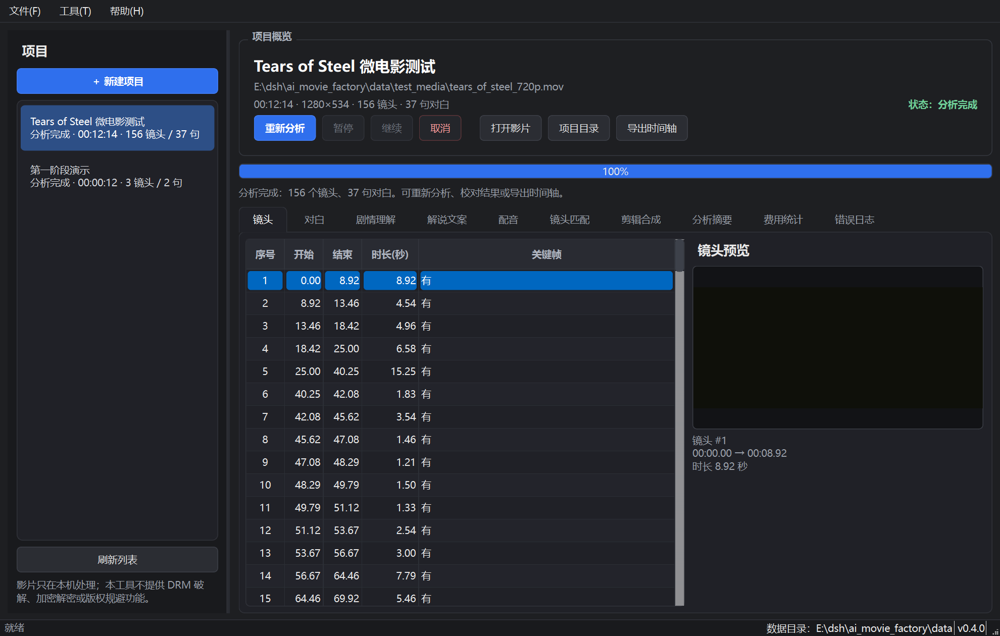
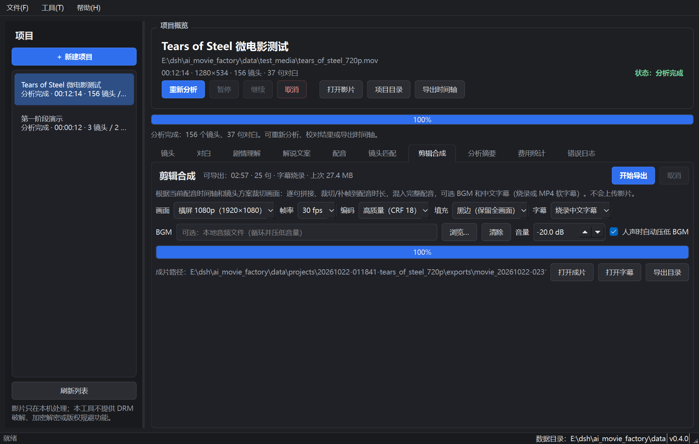

# AI电影解说工厂

[](https://github.com/jwutbt7137-lgtm/ai-movie-factory/actions/workflows/ci.yml)

面向个人创作者的 Windows 桌面工具，目标是把「导入电影 → 理解剧情 → 写解说 → 配音 → 匹配镜头 → 导出视频」逐步自动化。

> 开源仓库：<https://github.com/jwutbt7137-lgtm/ai-movie-factory>  
> 许可证：MIT（见 `LICENSE`）。示例影片 Tears of Steel 为 Blender Foundation 的 CC BY 3.0 作品，不随源码仓库分发。

当前版本 **v0.4.0（第一至第四阶段完成 + 第五阶段打包）**：

- 第一阶段：影片导入、镜头切分、关键帧、本地中文对白识别、时间轴持久化与桌面界面。
- 第二阶段：DeepSeek 分段剧情分析、六种风格原创解说文案、文案编辑与版本管理、Token/费用统计、缓存与预算拦截。
- 第三阶段：逐句中文配音、句子级时间轴、逐句音频缓存、启发式镜头匹配、人工审核标记。
- 第四阶段：手动换镜、逐句裁切/补帧、完整配音与 BGM 混音、中文字幕烧录/软字幕/SRT/ASS、横竖屏 MP4 导出。
- 第五阶段：Windows PyInstaller onedir 免安装包、依赖自检、BGM ducking、裁切填充、发布检查清单。
- 仍然没有视觉语义理解；镜头方案必须人工审核。没有转场/花字/主体跟踪智能裁切/安装器。




> 合规边界：本软件不提供 DRM 破解、加密视频解密、版权识别规避或“去重/镜像/变速”等规避手段。影片只在本机处理，不会自动上传。请仅导入具有合法使用依据的素材，发布前自行确认版权与平台规则；AI 文案必须人工核对事实、原创性与平台合规。

## 第二阶段已实现

- **DeepSeek 客户端**：OpenAI 兼容 Chat Completions；模型、Base URL、超时、重试、退避、单价、预算全部可配置。
- **API Key 安全**：只从环境变量 `DEEPSEEK_API_KEY`（名称可配置）读取，不写入配置/日志；日志统一脱敏。
- **分段剧情分析**：按对白字符数、时长和长静默间隙切分 → 逐段分析 → 整片整合；长片不会一次性塞入模型。
- **证据约束**：事件/冲突/转折必须引用对白编号；本地校验并移除无有效证据的断言，结果标记“待核实”；不确定内容进入 `uncertainties/review_notes`。
- **六种文案风格**：三分钟剧情速看、五分钟悬疑解说、十分钟剧情解析、人物心理分析、科幻电影深度解说、自定义风格。
- **文案证据关联**：每个段落保存剧情片段 ID、对白证据、候选镜头 ID 和事件描述，供第三阶段镜头匹配使用。
- **编辑与版本**：生成/重新生成/人工编辑都会追加新版本，旧版本不覆盖；可预览并恢复任意版本为当前版本。
- **费用与预算**：每次请求记录模型、Token、估算费用、耗时、缓存/失败状态；单项目预算、超预算确认、缓存命中不计费。
- **界面**：新增“剧情理解”“解说文案”页；费用页展示真实调用记录；设置页新增 AI 生成参数。
- **流水线**：AI 任务在后台线程执行，支持暂停（检查点）、取消；进度、错误日志、调用统计可见。
- **命令行**：新增 `story / script / scripts / costs`，可在无界面环境下使用。


## 第三阶段已实现（配音 + 句子时间轴 + 镜头匹配）

- **逐句中文配音**：按句末标点/长句逗号切分，逐句合成，支持语速、音量、音高、句间/段间停顿。
- **两个引擎**：Edge TTS（免费在线，无需 Key）与 Piper（完全本地，需自行提供有合法许可的中文 ONNX 模型）；可配置自动回退。
- **句子级时间轴**：每句保存开始/结束时间、逐句音频、所用引擎；完整 WAV 由逐句音频和停顿混合生成。
- **缓存与断点**：逐句音频按引擎/声音/参数/文本哈希缓存；相同文案重跑命中缓存，不重复合成。
- **隐私边界**：Edge TTS 只发送解说文案文本，不发送影片/关键帧/对白原文件；需要完全离线时改用 Piper。
- **镜头匹配（启发式）**：按文案段落关联的剧情片段、镜头时长、顺序连续性选择镜头；优先顺序推进，片段不够时用相邻镜头补足。
- **审核标记**：未接入画面视觉语义时，置信度上限 0.70，所有镜头选择标记“需人工审核”；低置信度/时长不足/复用镜头也会单独标记。
- **界面**：新增“配音”“镜头匹配”页；支持查看逐句时间轴、打开完整配音、查看候选镜头关键帧和匹配原因。
- **命令行**：新增 `tts / match`，无界面环境也能生成配音和匹配方案。
- **成本**：配音与匹配均不产生 DeepSeek API 费用；Edge 免费，Piper 本地免费。


## 第四阶段已实现（剪辑合成 + 字幕 + 导出）

- **手动换镜**：镜头匹配页逐句「编辑镜头」，可勾选任意候选镜头；保存为新的匹配方案版本，其他自动结果保留审核标记。
- **逐句自动剪辑**：按配音槽位（含停顿）裁切镜头；统一分辨率/帧率；不足补冻结帧，超出裁掉。
- **完整音轨**：混入 48kHz 完整配音；可选 BGM 循环、固定 dB 压低、可选人声 sidechain ducking，AAC 编码。
- **中文字幕**：按真实配音句子时间生成 SRT/ASS；支持烧录、MP4 `mov_text` 软字幕、无字幕三种模式。
- **横竖屏导出**：1920×1080 / 1280×720 / 1080×1920 / 1080×1080；24/25/30/60fps；H.264 CRF/preset 可调；黑边/裁切填充可选。
- **进度/取消**：逐句裁切和最终合成均有进度；取消会终止 FFmpeg、删除半成品。
- **界面**：新增「剪辑合成」页；主界面 10 个标签页。
- **命令行**：新增 `export-video`，无界面也能导出。
- **成本**：剪辑/字幕/导出全在本机 FFmpeg 运行，不产生 API 费用。




### 当前验收结果（2026-10-22）

- 自动化测试：**95 passed, 2 skipped**（跳过项是需要真实 Whisper 模型的旧集成测试；单独开启后 2 passed）。
- 真实微电影联调：**Tears of Steel**（Blender Foundation，CC BY 3.0，12:14，英文对白）
  - 第一阶段：156 镜头、37 句对白、本地 faster-whisper base，耗时 74.7 秒。
  - DeepSeek：4 次真实请求 + 3 次缓存命中，23,693 tokens，**实际产生约 ¥0.053958**；失败 0。
  - 剧情分析：1 段、17 个事件、5 个人物、2 个转折、6 条待核实。
  - 文案：v1 三分钟速看 913 字；v2/v3 五分钟悬疑解说 843 字；v3 当前（缓存重生成）。
  - 配音：真实 Edge TTS，25 句，总时长 **02:57（177.088 秒）**，逐句时间轴完整，费用 **¥0**；二次重跑全部命中缓存。
  - 匹配：25 句、156 镜头，平均置信度 **0.70**，**25 句需人工审核**（无画面视觉语义，不使用“看懂了画面”的假结论）。
  - 成片：**1280×720 / 24fps / H.264 + AAC**，**02:57（177.125 秒）**，**28,714,899 字节（约 27.4 MiB）**，中文 ASS 烧录，导出耗时 **51.39 秒**。
  - 成片文件：`data/test_media/tears_final_720p.mp4`；字幕：`data/test_media/tears_final_720p.srt`（本机生成，不随开源仓库分发）。
- Windows 打包：PyInstaller onedir，约 **487 MB**；`AIMovieFactory.exe --smoke-test` 退出码 **0**，GUI/Whisper/OpenCV/SceneDetect/AV/EdgeTTS 均可加载。
- 自动化测试使用离线假客户端/假 TTS/合成视频，真实联调独立进行；测试覆盖 TTS 时间轴/缓存/回退、镜头匹配、手动换镜、字幕、BGM、导出取消和 UI 加载。
- 第一阶段真实语音识别集成测试仍通过：`2 passed`。
- 真实联调详情：[`docs/真实微电影测试.md`](docs/真实微电影测试.md)；第三阶段说明：[`docs/配音与镜头匹配.md`](docs/配音与镜头匹配.md)；第四阶段说明：[`docs/剪辑合成与导出.md`](docs/剪辑合成与导出.md)；打包说明：[`docs/Windows打包与发布.md`](docs/Windows打包与发布.md)；测试记录：[`docs/测试记录.md`](docs/测试记录.md)。

## 环境要求

- Windows 10/11（开发验证：Windows 11 家庭版 26200）
- Python 3.11+（开发验证：3.13.1）
- FFmpeg / ffprobe 6.0+（开发验证：9.0.2-full_build）
- 首次使用语音识别时需要联网下载 Whisper 模型；之后完全离线
- 使用第二阶段 AI 功能时，需要可访问 DeepSeek API 的网络和用户自己的 API Key
- 配音：Edge TTS 需要网络（免费、无需 Key）；Piper 本地引擎需自备有合法许可的中文 ONNX 模型
- 镜头匹配和配音不调用 DeepSeek，不产生 API 费用

## 安装与运行

```bat
cd /d E:\dsh\ai_movie_factory
scripts\setup_windows.cmd
run.cmd
```

如果 FFmpeg 不在 PATH，请在「设置 → 路径与日志」填写 `ffmpeg.exe` / `ffprobe.exe` 路径。

可选：使用本地 Piper 配音（需自备有合法许可的中文 ONNX 模型）：

```bat
.venv\Scripts\pip.exe install "piper-tts>=1.8"
```

### Windows 打包

```bat
scripts\build_windows.ps1
```

产物：`dist\AIMovieFactory\`（约 487 MB，onedir）。启动：

```bat
dist\AIMovieFactory\run.cmd
```

打包/依赖自检：

```bat
set AIMOVIE_DATA_DIR=%CD%\data
set QT_QPA_PLATFORM=offscreen
dist\AIMovieFactory\AIMovieFactory.exe --smoke-test
```

FFmpeg/ffprobe 不随包分发；目标机需安装并加入 PATH，或在设置中指定。Whisper/Piper 模型也不随包分发。详见 [`docs/Windows打包与发布.md`](docs/Windows打包与发布.md)。

### 生成合法测试素材

```bat
.venv\Scripts\python.exe scripts\make_sample_video.py
```

生成 3 个图案镜头、约 12 秒、带中文旁白的合成影片，无版权风险。仓库附带 `sample_media/narration.wav`，脚本会优先复用。

## 使用 DeepSeek（第二阶段）

### 1. 配置 Key

只通过环境变量提供，不要写入配置文件：

```bat
set DEEPSEEK_API_KEY=你的Key
run.cmd
```

设置后重启程序。程序只显示“已配置/未配置”，不会显示 Key 内容。

### 2. 设置模型、单价与预算

「设置 → DeepSeek」：

- 接口地址、文本模型
- 超时、重试次数、退避
- 输入/输出单价（元/百万 tokens）
- 单项目预算（0 表示不限制）

「设置 → AI 生成」：

- 剧情分段字符数、单段最长时长、最少对白字符数、输出 token、温度
- 解说语速（默认 240 字/分钟）、默认时长、文案温度、段落上限
- 请求缓存、重试退避

「设置 → 配音与匹配」：

- 配音引擎：自动 / Edge / Piper；Edge 声音、Piper ONNX 模型路径
- 语速、音量、音高、句间/段间停顿、每句最大字符
- 备用引擎回退、逐句音频缓存
- 镜头匹配置信度阈值、时长余量、每句最多镜头数、是否扩展到相邻镜头

### 3. 操作流程

1. 完成第一阶段：导入影片 → 镜头切分 → 本地对白识别。
2. 打开「剧情理解」→「运行剧情分析」。
   - 若预计超预算，会先弹出确认；选择“否”不会发起新调用。
   - 首次会按分段多次调用 DeepSeek；结果保存到项目数据库。
3. 核对“剧情理解”中的事件、人物、转折与待核实项。
4. 打开「解说文案」→ 选择风格/时长 →「生成文案」。
   - 每个段落显示关联剧情片段与候选镜头。
5. 在右侧编辑标题/正文 →「保存编辑为新版本」；左侧版本下拉可预览，点击“恢复为当前版本”切换当前版本。
6. 打开「配音」→ 选择引擎/声音/语速/停顿 →「生成配音」。
   - Edge 免费但在线；Piper 完全本地，需要先在设置里指定合法许可的中文 ONNX 模型。
   - 生成后逐句时间轴、每句音频和完整 WAV 会保存到项目目录；再次生成相同文案会命中逐句缓存。
7. 打开「镜头匹配」→「自动匹配镜头」。
   - 当前没有画面视觉语义，匹配只依据剧情片段、镜头时长和连续性，因此全部标记“需人工审核”。
   - 选中某句 →「编辑镜头」可手动勾选镜头；保存为新的方案版本。
8. 试听「打开配音文件」，人工核对断句、多音字、专有名词和镜头顺序。
9. 打开「剪辑合成」→ 选择画面/帧率/质量/字幕/BGM →「开始导出」。
   - 导出会按配音槽位裁切镜头、补冻结帧、混入配音/BGM、烧录字幕并写 SRT/ASS。
   - 可取消；完成后「打开成片」检查全片。
10. 「费用统计」查看 DeepSeek 成本；配音、匹配、剪辑、导出均不产生 API 费用。

> 预算拦截是调用前的保守估计 + 调用前检查，不保证与实际账单完全一致；最终以 DeepSeek 账单为准。缓存命中不重复计费。
>
> 注意：仓库里的 12 秒合成演示片只有 2 句对白，低于剧情分析的安全下限（默认 120 字），点击“运行剧情分析”会提示证据不足；这是为了避免用模型常识补全剧情。请使用有足够对白的真实测试影片。
>
> 更完整的配置、费用公式与首次联调建议见 [`docs/DeepSeek配置与成本.md`](docs/DeepSeek配置与成本.md)。

## 命令行

```bat
run-cli.cmd --help
run-cli.cmd info sample_media\sample_movie.mp4
run-cli.cmd analyze sample_media\sample_movie.mp4 --skip-speech
run-cli.cmd analyze data\test_media\tears_of_steel_720p.mov --whisper-model base --whisper-language en
run-cli.cmd projects
run-cli.cmd export <PROJECT_ID> --out timeline.json

rem 第二阶段（会调用付费 API，请先设置 Key）
run-cli.cmd story <PROJECT_ID>
run-cli.cmd script <PROJECT_ID> --style quick3 --minutes 3 --out script.txt
run-cli.cmd scripts <PROJECT_ID>
run-cli.cmd costs <PROJECT_ID>

rem 第三阶段（配音/匹配免费；配音需要网络或本地模型）
run-cli.cmd tts <PROJECT_ID> --engine edge --voice zh-CN-XiaoxiaoNeural --out voiceover.wav
run-cli.cmd match <PROJECT_ID> --json

rem 第四阶段（本机 FFmpeg 导出，免费）
run-cli.cmd export-video <PROJECT_ID> --out-dir exports --width 1280 --height 720 --fps 24 --crf 23 --preset veryfast --subtitle burn
```

- `story` 与 `script` 默认在预计超预算时停止；确认后加 `--allow-over-budget`。
- `--style` 可选 `quick3/suspense5/analysis10/psychology/scifi/custom`；自定义需 `--custom-instruction`。
- 真实调用失败时按配置重试；失败/取消前已成功的相同请求再次执行会命中缓存。
- `tts` 会逐句合成并保存完整 WAV/句子时间轴；`--engine piper` 需先在设置中配置 `.onnx` 模型。
- `match` 输出逐句镜头与置信度；未接入视觉语义时所有结果均标记需审核。
- `export-video` 按当前配音/镜头方案导出 MP4；`--subtitle none` 关闭烧录（仍写 SRT/ASS），`--bgm` 可选。

## 数据与隐私

默认数据目录：`<项目根>/data`（可用 `AIMOVIE_DATA_DIR` 覆盖）。

```text
data/
  app.db                  # 项目、媒体、镜头、对白、剧情分析、文案版本、API 调用账目、缓存
  config.json             # 应用配置（不含 API Key）
  logs/app.log            # 滚动日志（已脱敏）
  models/whisper/         # Whisper 模型缓存
  projects/<项目目录>/
    timeline.json         # 第一阶段时间轴
    keyframes/*.jpg       # 镜头缩略图
    audio/audio_16k.wav   # 语音识别用的本机音频副本
    voiceover/
      cache/*.mp3|wav     # 逐句配音缓存
      <run>/voiceover.wav # 完整配音轨 + 逐句音频
    exports/
      movie_*.mp4         # 成片
      movie_*.srt/.ass    # 字幕
```

- 影片、音频、关键帧不会自动上传到任何第三方。
- 剧情分析只把“对白文本 + 时间/镜头编号”发送给 DeepSeek；未发送视频文件、关键帧或本机路径。
- Edge TTS 只发送解说文案文本给 Microsoft 语音服务；完全离线请使用 Piper。关键帧和影片文件不发送。
- API Key 只从环境变量读取，不写入配置文件、数据库或日志。
- 请求/响应正文不写入日志；缓存内容保存在本机 SQLite 中。

## 测试

```bat
.venv\Scripts\python.exe -m pytest -q
```

真实语音识别集成测试默认跳过：

```bat
set AIMF_RUN_INTEGRATION=1
.venv\Scripts\python.exe -m pytest tests\test_speech_integration.py tests\test_pipeline_integration.py -v -s
```

说明：

- 真实 FFmpeg、PySceneDetect、faster-whisper、SQLite 均参与测试；流水线测试使用**显式命名的假检测器/假识别器**验证状态机，不把假数据当作真实 AI 结果。
- DeepSeek 自动化测试使用**假客户端 + 本机 HTTP 服务**，覆盖请求结构、重试、缓存、鉴权、预算拦截；不访问外网、不产生费用。
- TTS 自动化测试使用**假 TTS 引擎生成真实 WAV**，覆盖时间轴、句间/段间停顿、缓存、回退、取消与 DB 持久化；不访问 Edge/Piper 网络。
- 镜头匹配测试使用真实 SQLite/时间轴数据，覆盖候选镜头、时长覆盖、低置信度、旧配音拒绝、手动换镜版本。
- 导出测试使用真实 FFmpeg + 合成短片，覆盖字幕、烧录、BGM、无烧录、取消、SRT/ASS 与 DB；不访问外网。
- 另有一次性真实联调记录（Tears of Steel，DeepSeek 约 ¥0.054、Edge TTS 免费、成片约 27.4 MiB），见 [`docs/真实微电影测试.md`](docs/真实微电影测试.md)；真实联调不放进自动化测试套件，避免重复计费/网络依赖。

## 已知限制

- 真实 DeepSeek 已用英文 CC 短片联调，但**中文真实影片、长片和不同模型/账号网关尚未验证**；费用为本地单价估算，实际账单以 DeepSeek 为准。
- 文本剧情分析只覆盖有对白的部分：Tears of Steel 的对白在 07:02 前结束，后 5 分钟画面/动作没有被分析。
- 未接入视觉模型；关键帧没有参与剧情分析，动作/场景/视觉线索需人工核对。
- 只读取字幕轨元数据，未提取字幕文本；对白来自语音识别。
- 剧情分析/文案仍是 AI 生成，存在误读、错字、事实混淆风险；全局标记“需人工审核”，不能直接发布。
- 未提供自动化原创性/抄袭检测；只能通过提示词要求原创并人工审核。
- **镜头匹配不是视觉语义匹配**：未接入画面理解，仅按剧情片段/时长/连续性；全部结果需人工审核；手动换镜已提供，但只能按镜头序号勾选，不能裁切/拖拽/转场。
- **配音需试听**：多音字、专有名词、数字和语气可能读错；Edge 需要网络，Piper 需要用户自行准备有合法许可的模型。
- 字幕支持烧录/MP4 软字幕/无；软字幕的播放器兼容性取决于目标播放器。
- BGM 可选自动 sidechain ducking，也可关闭；没有多段音乐/淡入淡出编辑。
- 竖屏/方形可选黑边 pad 或中心裁切，但没有主体跟踪智能裁切；没有转场、花字、片头片尾。
- 暂停在检查点生效；正在执行的单次 HTTP/ffmpeg/TTS 调用会先完成。视频导出不支持暂停，只支持取消。
- 只有 onedir 免安装包，没有 MSI/安装器/代码签名/自动更新；包体积约 487 MB。
- 打包未包含 FFmpeg、Whisper/Piper 模型；目标机需准备。
- 长片性能/磁盘/并发压测、项目自动恢复尚未完成。
- 长片与大量并发调用尚未做性能/成本压测；建议先用 3–10 分钟片段测试预算。

## 开发结构

```text
src/aimovie/
  config.py                 # 配置（模型、接口、价格、预算、分段/文案参数）
  models.py                 # Pydantic：时间轴、剧情分析、文案、API 调用、费用
  db.py                     # SQLite：项目/镜头/对白/分析/版本/账目/缓存
  media/                    # ffprobe、镜头切分、缩略图、ffmpeg
  speech/                   # faster-whisper
  pipeline/                 # 第一阶段流水线、暂停/取消
  llm/                      # DeepSeek 客户端、JSON 解析、Token/价格
  analysis/                 # 分段、提示词、证据校验、整片整合
  copywriting/              # 风格、提示词、生成、编辑/版本
  tts/                      # 句子切分、Edge/Piper 引擎、逐句合成与完整音轨
  matching/                 # 剧情片段/时长/连续性镜头匹配、人工换镜
  export/                   # 字幕 SRT/ASS、逐句裁切、BGM、FFmpeg 成片
  costs/                    # 费用统计与预算判断
  ui/                       # 主窗口、剧情/文案/配音/匹配/剪辑面板、设置、后台线程
  cli.py                    # 命令行
aimovie.spec                # PyInstaller onedir 配置
tests/                      # pytest
scripts/                    # 安装、构建、合成素材、UI 截图
```

## 后续阶段

- 第四阶段已完成核心：手动换镜、逐句自动剪辑、完整配音/BGM、中文字幕、横竖屏 MP4 导出。
- 第五阶段：onedir 打包/自检、软字幕、BGM ducking、裁切填充已完成；剩余视觉语义/镜头描述、转场/花字、项目恢复、性能压测、安装器/签名。

详细进度与测试记录见 [`docs/开发进度.md`](docs/开发进度.md)。

## 许可证

本项目以 **MIT License** 开源，详见 [`LICENSE`](LICENSE)。

- 源码、文档、界面截图可自由使用、修改、分发，保留版权与许可声明。
- **不包含**：Tears of Steel 影片（Blender Foundation，CC BY 3.0，仅本机测试）、Whisper/Piper 模型、FFmpeg 二进制、用户的 API Key 与生成数据。
- 使用 Edge TTS、DeepSeek、FFmpeg、Whisper、Piper 及任何影片素材时，仍需遵守各自的服务条款、模型许可与影片版权。
- AI 生成的文案可能存在事实错误；发布前必须人工核对事实、原创性与平台规则。
