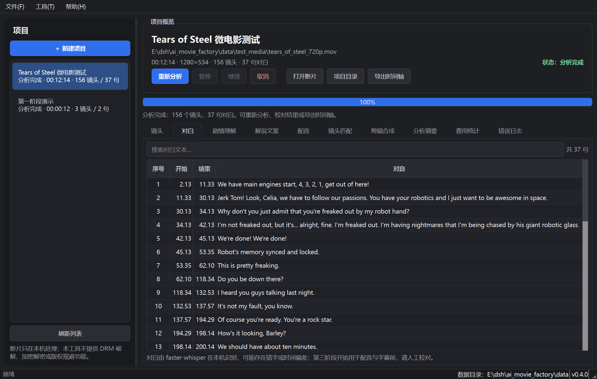
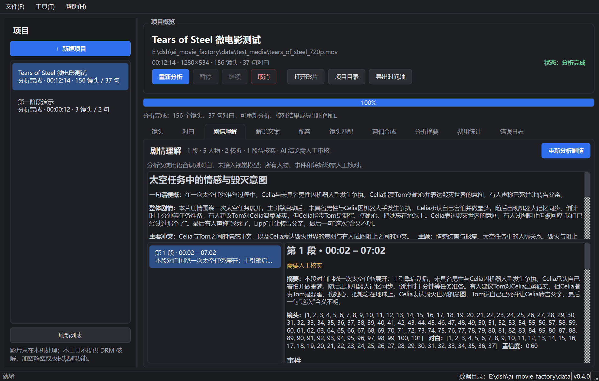
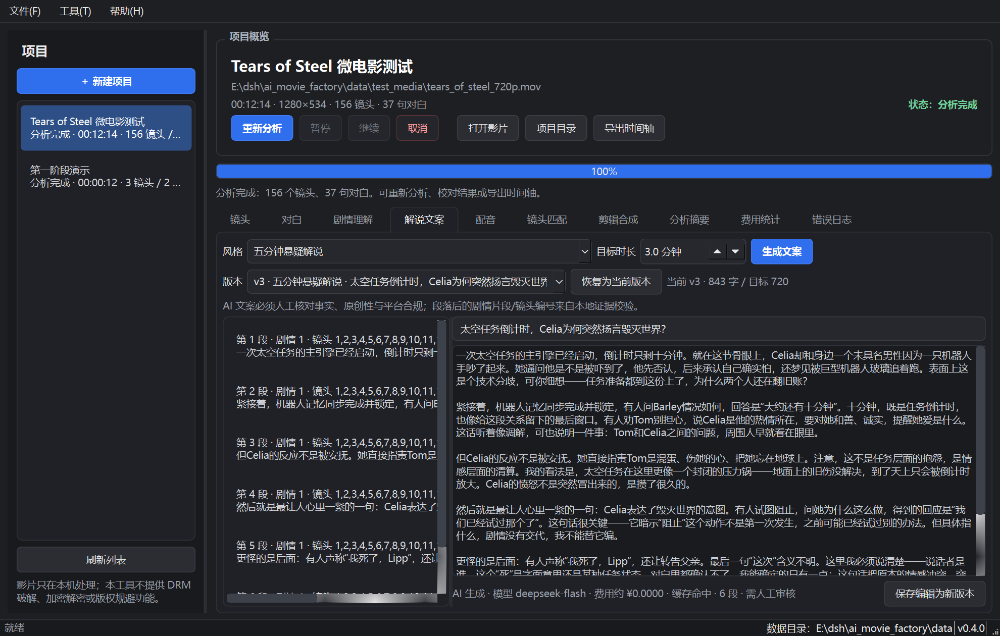
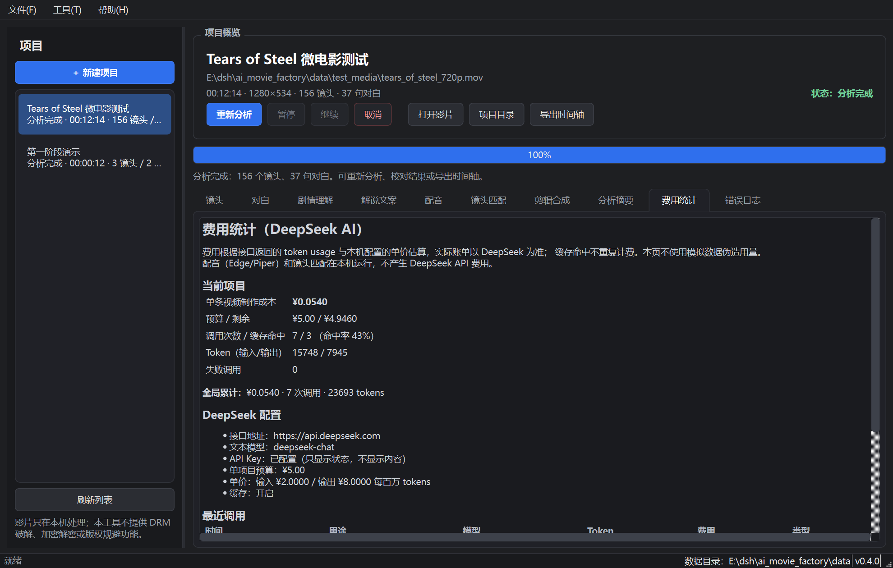
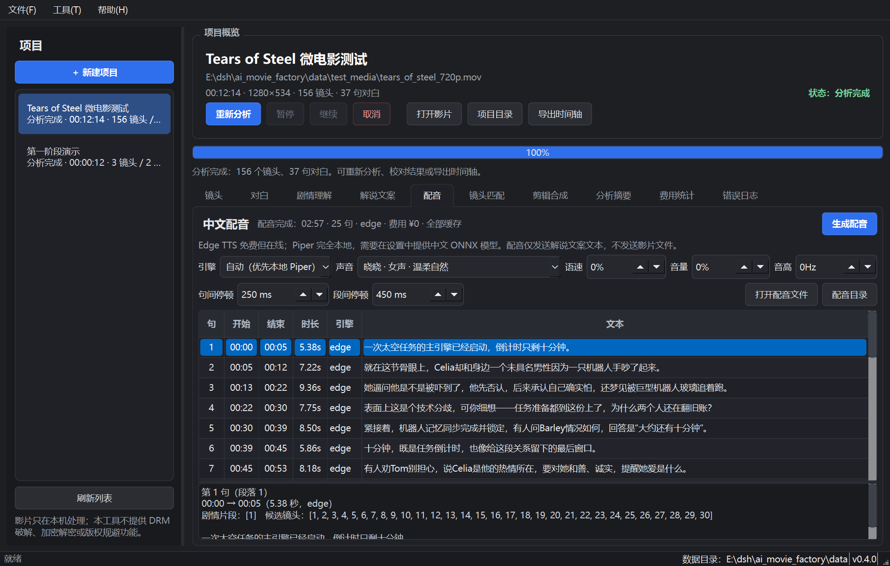
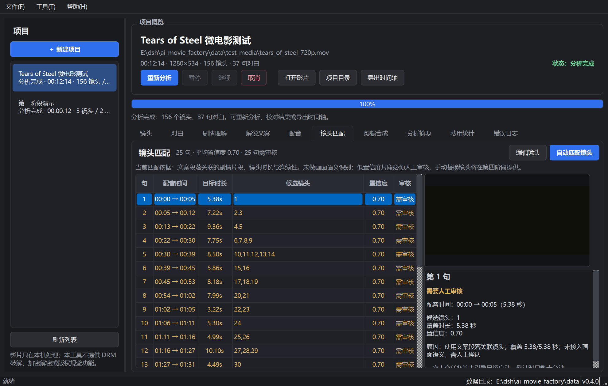
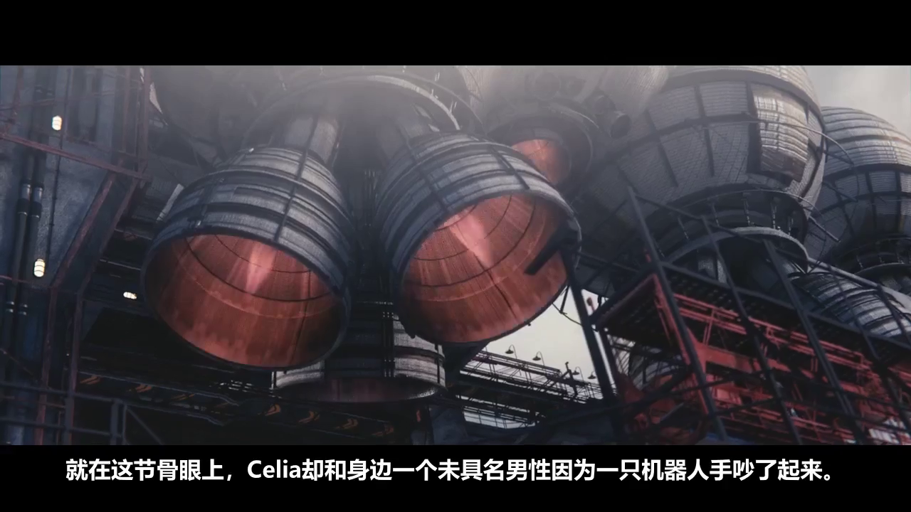

# 真实微电影联调记录

- 日期：2026-10-22
- 用途：验证第一阶段 ASR 与第二阶段 DeepSeek 剧情分析/文案生成的真实链路
- 说明：只使用具有明确开放许可的短片；影片和 AI 文案仅保存在本机数据目录，不随软件仓库分发。

## 1. 测试影片与许可

| 项目 | 内容 |
|---|---|
| 片名 | Tears of Steel（2012） |
| 出品 | Blender Foundation |
| 许可 | Creative Commons Attribution 3.0（CC BY 3.0） |
| 官方页面 | <https://mango.blender.org/> |
| 下载 | `https://download.blender.org/demo/movies/ToS/tears_of_steel_720p.mov` |
| 本地文件 | `data/test_media/tears_of_steel_720p.mov`（372,178,639 字节） |
| 技术信息 | 12:14，1280×534，24 fps，h264 + mp3，英文对白 |

原始版权/许可说明保存在 `data/test_media/NOTICE.txt`。影片不放入源码仓库，也不对外分发。本记录中的 `data/test_media/` 生成产物同样只在本机，不随开源仓库提交。

## 2. 第一阶段真实结果

- 镜头切分：156 个镜头（PySceneDetect）
- 本地语音识别：faster-whisper **base**、int8、CPU、`language=en`
- 识别结果：37 句对白，1377 个字符
- 处理耗时：74.7 秒
- 失败：0
- 时间轴：`data/projects/20261022-011841-tears_of_steel_720p/timeline.json`

ASR 是真实的英文识别，存在专有名词/断句错误；显示在界面的对白未美化。识别到的对白在 **07:02** 左右结束，之后到 12:14 没有可靠对白，所以文本剧情分析只覆盖了前 7 分钟。这是本测试最重要的限制之一。



## 3. 第二阶段真实 DeepSeek 运行

API Key 由用户在会话中临时提供，仅通过环境变量传入进程；**未写入项目配置、数据库或日志**。测试后应自行轮换该 Key。

### 3.1 调用与费用

| 指标 | 实际值 |
|---|---|
| 成功调用记录 | 7 次（4 次真实请求 + 3 次本地缓存命中） |
| 失败调用 | 0 |
| 输入 tokens | 15,748 |
| 输出 tokens | 7,945 |
| 总 tokens | 23,693 |
| 实际产生费用（按本机配置单价估算） | **¥0.053958** |
| 项目预算 | ¥5.00 |
| 剩余预算 | ¥4.946042 |

4 次真实调用的用途与费用：

| 用途 | 输入+输出 tokens | 费用 |
|---|---|---|
| `story_segment_1` | 2175+1620 | ¥0.017310 |
| `story_integration` | 1927+956 | ¥0.011502 |
| `script_quick3` | 2514+979 | ¥0.012860 |
| `script_suspense5` | 2515+907 | ¥0.012286 |

之后重复运行相同剧情分析和相同文案，均命中缓存，费用为 0。缓存命中时仍写入调用记录（类型“缓存”）。

配置请求模型为 `deepseek-chat`；接口响应中的模型标识为 `deepseek-flash`。本机账目中的早期记录使用配置模型名，后续代码已改为记录接口返回的实际模型名。费用按本机配置的 2 元/8 元每百万 tokens 估算，真实账单以 DeepSeek 为准。

### 3.2 剧情分析结果

- 标题：**太空任务中的情感与毁灭意图**
- 一句话梗概：一次太空任务准备过程中，Celia 与未具名男性因机器人手发生争执，Celia 指责 Tom 伤她心并表达毁灭世界的意图，有人声称已死并让转告父亲。
- 分段：1 段（00:02–07:02）
- 事件：17 个
- 人物：5 个
- 转折：2 个
- 待核实：6 条
- 全局标记：需人工审核
- 未做视觉分析：是

完整结构化结果：`data/test_media/tears_story_analysis.json`



### 3.3 文案结果

| 版本 | 风格 | 字数 | 费用 | 状态 |
|---|---|---|---|---|
| v1 | 三分钟剧情速看 | 913 | ¥0.012860 | 保留 |
| v2 | 五分钟悬疑解说 | 843 | ¥0.012286 | 保留 |
| v3 | 五分钟悬疑解说 | 843 | ¥0.000000（缓存） | 当前版本 |

v3 是当前版本，基于最新一次剧情分析时间戳，文案内容与 v2 相同（缓存）。完整文案：`data/test_media/tears_script_current.md`

开头两段：

> 一次太空任务的主引擎已经启动，倒计时只剩十分钟。就在这节骨眼上，Celia却和身边一个未具名男性因为一只机器人手吵了起来。她逼问他是不是被吓到了，他先否认，后来承认自己确实怕，还梦见被巨型机器人玻璃追着跑。表面上这是个技术分歧，可你细想——任务准备都到这份上了，为什么两个人还在翻旧账？
>
> 紧接着，机器人记忆同步完成并锁定，有人问Barley情况如何，回答是“大约还有十分钟”。十分钟，既是任务倒计时，也像给这段关系留下的最后窗口。有人劝Tom别担心，说Celia是他的热情所在，要对她和善、诚实，提醒她爱是什么。这话听着像调解，可也说明一件事：Tom和Celia之间的问题，周围人早就看在眼里。





## 4. 第三阶段：配音与镜头匹配

### 4.1 真实 Edge TTS

- 引擎：Edge TTS，声音 `zh-CN-XiaoxiaoNeural`
- 文案：v3《五分钟悬疑解说》，843 字
- 数据边界：只把解说文案文本逐句发送给 Microsoft 语音服务；影片、关键帧、对白原文件未发送
- 切分：25 句（6 个段落）
- 完整音轨：**02:57（177.088 秒）**，48kHz 单声道 WAV，约 17 MB
- 逐句缓存：25 个逐句音频文件，位于项目 `voiceover/cache/`
- 重跑验证：第二次相同文案/参数全部命中缓存，`Voiceover.cached=True`，费用仍为 ¥0
- API/服务费用：**¥0**
- 失败：0

产物：

- `data/test_media/tears_voiceover.wav`
- `data/test_media/tears_voiceover_timeline.json`
- 原始日志：[`test-logs/real-tears-tts.log`](test-logs/real-tears-tts.log)、
  [`test-logs/real-tears-tts-cache.log`](test-logs/real-tears-tts-cache.log)



### 4.2 真实镜头匹配

- 当前文案 25 句 + 当前配音时间轴 + 156 个镜头
- 规则匹配：从上一句结束镜头之后顺序推进；候选来自剧情片段；时长不足时扩展到相邻镜头
- 结果：25 句全部有候选镜头，平均规则置信度 **0.70**
- **25 句全部标记“需人工审核”**：没有接入画面视觉语义，不能声称“看懂了画面”
- 使用镜头约 54 个（序号 1–54，按句推进）
- 匹配产物：`data/test_media/tears_shot_match.json`
- 原始日志：[`test-logs/real-tears-match.log`](test-logs/real-tears-match.log)



### 4.3 第三阶段限制

- 匹配只使用片段/时长/连续性，不是画面语义匹配；全部结果需人工审核。
- 第三阶段本身不导出视频；第四阶段已提供逐句手动换镜、字幕和成片导出，见下文。
- Edge TTS 需要网络；Piper 本地模型未随项目分发，许可由使用者确认。
- 配音和匹配不产生 DeepSeek 费用，因此费用页仍只显示 DeepSeek 的 ¥0.054。

## 5. 第四阶段：真实成片导出

- 输入：当前配音 v3（25 句，177.088 秒）+ 当前镜头方案（25 句，54 个镜头片段）+ 源片
- 输出：**1280×720，24fps，H.264 + AAC 192k，双声道**
- 时长：**177.125 秒（02:57）**
- 大小：**28,714,899 字节（约 27.4 MiB）**
- 字幕：中文 ASS 烧录；同名 SRT/ASS 边车文件
- BGM：无
- 导出耗时：**51.39 秒**
- 实现路径：逐句裁切/补冻结帧 → 25 个临时片段 → concat demuxer → 最终字幕/音频合成
- 结果：真实成片可播放，画面、中文烧录字幕、完整配音均存在

产物：

- 成片：`data/test_media/tears_final_720p.mp4`
- 字幕：`data/test_media/tears_final_720p.srt`
- 画面抽帧：[`screenshot_export_frame.png`](screenshot_export_frame.png)
- 导出页：[`screenshot_export.png`](screenshot_export.png)



### 5.1 第四阶段限制

- 镜头方案仍是无视觉语义的启发式；成片可用不等于镜头语义正确，必须人工完整观看。
- 手动换镜只能按镜头序号勾选，不能拖拽重排、裁切单镜头、加转场。
- 本次成片用“烧录字幕+无 BGM”；软字幕、BGM ducking、裁切填充虽已实现/测试，但未做真实播放器兼容性与主观听感验证。
- 竖屏/方形可选 pad/crop，但没有主体跟踪智能裁切。
- 成片没有片头片尾、花字、转场；Windows 打包尚未完成。

## 6. 观察到的优点

- 真实 DeepSeek 接口可用，JSON 格式稳定，分段分析与整片整合均成功。
- 文案能围绕对白证据展开，主动区分“事实”和“推测”，例如明确写出“具体指什么，剧情没有交代，我不能替它编”。
- 缓存生效：重复运行同一剧情分析/文案，费用为 0，且没有再次发出请求。
- 费用与 Token 记录和 API 返回一致；预算远低于 5 元上限。
- Edge TTS 真实可用：843 字切成 25 句，生成 2:57 完整音轨，逐句时间轴与缓存均正常。
- 镜头匹配没有伪造视觉理解：无视觉语义时所有结果自动标记人工审核。

## 7. 暴露的问题/限制

1. **文本分析只覆盖前 7 分钟**：ASR 在 07:02 后没有对白，后续 5 分钟画面/动作完全没有进入模型上下文。文本模型无法分析无对白段落；必须接入视觉适配器或人工补充镜头描述。
2. **ASR 错误会影响剧情**：英文 base 模型出现专有名词、断句和语义错误，模型可能据此误读人物关系；界面已标记待核实，但正式使用必须人工校对。
3. **画面视觉缺失**：未发送关键帧；动作、场景、表情、结局转折无法验证。
4. **模型标识不一致**：请求 `deepseek-chat`，响应标识 `deepseek-flash`；已改为记录实际模型名，但需确认账号/网关的实际计费模型。
5. **费用为本地估算**：单价是配置值，真实账单以 DeepSeek 为准；本次约 ¥0.054。
6. **中文真实影片未测**：本次是英文对白、CC 短片；中文长片的 ASR、分段和文案仍需用合法素材再测。
7. **AI 文案仍需人工审核**：存在专有名词/剧情误读风险；不构成可直接发布的成品。

## 8. 安全与清理

- Key 仅通过环境变量传递，没有写入配置文件、SQLite 或日志；但已出现在本次会话中，建议用户测试后轮换。
- 影片文件位于 `data/test_media/`，属于本机数据目录，不随源码分发；删除该目录不会影响软件运行。
- 测试产生的项目 ID：`a1001c4bda8d47e0`。
- 可复现命令：

```bat
set DEEPSEEK_API_KEY=...
python -m aimovie.cli --data-dir data analyze data\test_media\tears_of_steel_720p.mov --name "Tears of Steel 微电影测试" --whisper-model base --whisper-language en
python -m aimovie.cli --data-dir data story a1001c4bda8d47e0
python -m aimovie.cli --data-dir data script a1001c4bda8d47e0 --style quick3 --minutes 3
python -m aimovie.cli --data-dir data tts a1001c4bda8d47e0 --engine edge --voice zh-CN-XiaoxiaoNeural --out data\test_media\tears_voiceover.wav
python -m aimovie.cli --data-dir data match a1001c4bda8d47e0 --json
python -m aimovie.cli --data-dir data export-video a1001c4bda8d47e0 --width 1280 --height 720 --fps 24 --crf 23 --preset veryfast --subtitle burn
python -m aimovie.cli --data-dir data costs a1001c4bda8d47e0
```

原始日志：

- [`test-logs/real-tears-analyze.log`](test-logs/real-tears-analyze.log)
- [`test-logs/real-tears-story.log`](test-logs/real-tears-story.log)
- [`test-logs/real-tears-story-cache.log`](test-logs/real-tears-story-cache.log)
- [`test-logs/real-tears-script-v1.log`](test-logs/real-tears-script-v1.log)
- [`test-logs/real-tears-script-v2.log`](test-logs/real-tears-script-v2.log)
- [`test-logs/real-tears-script-v3-cache.log`](test-logs/real-tears-script-v3-cache.log)
- [`test-logs/real-tears-tts.log`](test-logs/real-tears-tts.log)
- [`test-logs/real-tears-match.log`](test-logs/real-tears-match.log)
- [`test-logs/real-tears-export.log`](test-logs/real-tears-export.log)
- [`test-logs/real-tears-costs.log`](test-logs/real-tears-costs.log)
